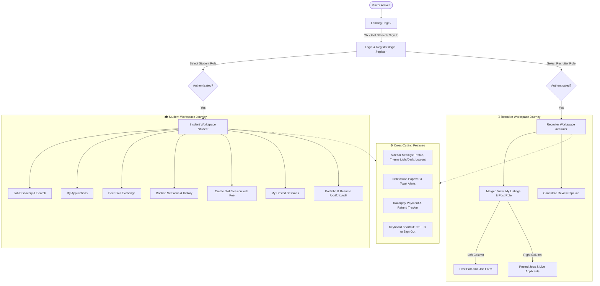
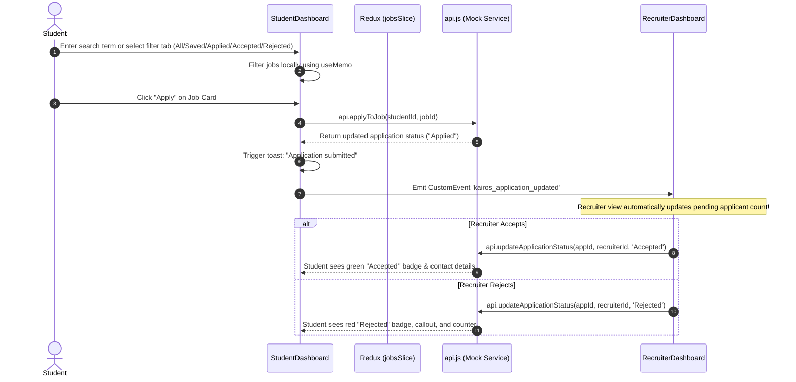
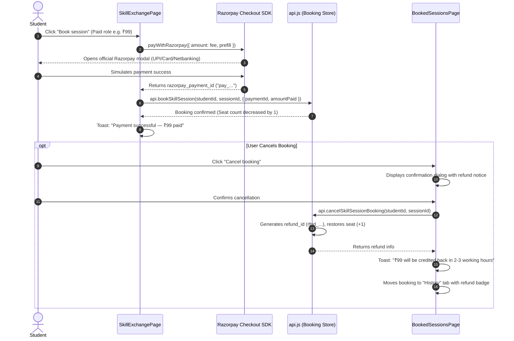

# Kairos - Application User & Data Flow Guide

This document outlines the complete user journeys, data flow, status lifecycles, Razorpay payment & refund flows, and cross-cutting event mechanisms across the Kairos platform.

---

## 1. High-Level System Flow Diagram

---

## 2. Authentication & Authorization Flow

1. **Visitor Landing**:
   - The user visits the app root (`/#/`).
   - The landing page showcases the value proposition, live stats, student peer exchange, and dual entry points.

2. **Login / Registration**:
   - Route: `/#/login` or `/#/register`.
   - Dual-role switch: `Student` or `Recruiter`.
   - **Demo Accounts Button**: Quick-fill dropdown at the top of the login screen allows instant evaluation without typing credentials.
   - Upon successful credentials verification in `api.login()`, the user object and authentication token are saved in `AuthContext` (persisted in `localStorage`).

3. **Role-Based Redirection (`ProtectedRoute.jsx`)**:
   - Checks if user is authenticated: if not, redirects to `/login`.
   - Checks if user has the required role (`allowedRole`):
     - `Student` trying to access `/recruiter` is redirected to `/student`.
     - `Recruiter` trying to access `/student` is redirected to `/recruiter`.

---

## 3. Student Workflow Details

### A. Job Discovery & Application Flow

1. **Browse Roles**: Students filter through campus and hybrid jobs by keyword, category, or status tab (`All`, `Saved`, `Applied`, `Accepted`, `Rejected`).
2. **Detailed View**: Full role description, recruiter company details, and compensation.
3. **Save for Later**: Clicking the bookmark icon toggles saved jobs instantly.
4. **My Applications Tab**: Tracks all submitted roles with status badges:
   - `Applied / Under Review` (Gold badge)
   - `Accepted` (Green badge with employer contact instructions)
   - `Rejected` (Red badge with respectful feedback notice)
   - `Positions Filled` badge when vacancies run out.
   - `Saved` (Blue badge)

---

### B. Peer Skill Exchange & Razorpay Payment/Refund Flow

1. **Browse Sessions**: Students discover micro-learning workshops with clear fee badges (`Free` or `₹99`, `₹199`).
2. **Book Paid Session**: Clicking book triggers Razorpay Checkout dynamically. Once approved, `api.bookSkillSession` stores the `paymentId` and marks the session as booked.
3. **Seat Management**: Available seats decrement immediately. Sessions with 0 seats remaining show `Full`.
4. **Cancellation & Refund**:
   - Students can cancel from **"Booked sessions"** before a meeting link is shared.
   - For paid sessions, a modal confirms the refund initiation.
   - Generates a tracking ID (`rfnd_...`), increments the seats back by 1, and moves the session to the **History** tab.
   - Displays: *"Refund initiated (₹XX) · Expected in 2-3 working days"* along with notification alerts.
5. **Attendee-Only Meeting Links**:
   - In "My sessions", the host can provide a Google Meet/Zoom link.
   - Enrolled students receive a notification and a **"Join meeting"** button.
   - Once a link is provided, cancellation is locked to safeguard confirmed sessions.

---

### C. Student Portfolio & Resume Flow
- Accessible from sidebar: **Edit portfolio** (`/#/portfolio/edit`) and **View portfolio** (`/#/profile`).
- Students can update their Bio, add taggable Skills, link GitHub/Live projects, and upload a PDF resume file.
- When applying to jobs, recruiters see the student's name, college, course, bio, and resume link.

---

## 4. Recruiter Workflow Details

### A. Unified Job Posting & Management Flow
1. **My listings**: Displays the merged two-column layout with posted job listings and fast job creation form.
2. **Applicants**: Dedicated candidate review pipeline with live **pending reviews counter badge**.
3. **Publishing a Role**: Validated and added to the store via Redux `createJob` without page reload.
4. **Managing Postings**: Pause/activate listings or remove jobs.

### B. Candidate Review Pipeline Flow
- **Final Decisions**: Once marked **Accepted** or **Rejected**, decisions are permanent.
- **Auto-Pausing & Auto-Rejection**: When the last vacancy for a job is accepted, the listing automatically pauses and remaining applicants receive an auto-rejected status with "Positions Filled" indicators.
- Quick `mailto:` button allows direct email communication with accepted students.

---

## 5. Real-Time Cross-Tab & Event Flow

The app maintains synchronized state across multiple browser tabs and components without a heavy websocket server:
- **Custom Event Bus**: `window.dispatchEvent(new CustomEvent('kairos_application_updated'))` and `new Event('kairos_sessions_updated')`.
- **Storage Sync**: `window.addEventListener('storage', ...)` and `localStorage` persistence sync session and application states.

---

## 6. Theme & Settings Flow

1. **Sidebar Settings Trigger**: Available in both Student and Recruiter sidebars at the bottom.
2. **Appearance Switch**: Clicking **Light** or **Dark** updates `ThemeContext`, adding/removing `.dark-theme` on `document.body`.
3. **Sign Out**: Click "Log out" or press <kbd>Ctrl</kbd> + <kbd>B</kbd> keyboard shortcut.
