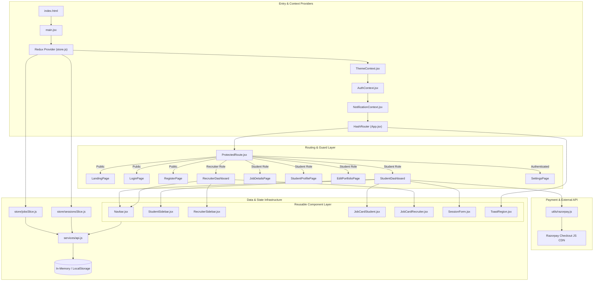
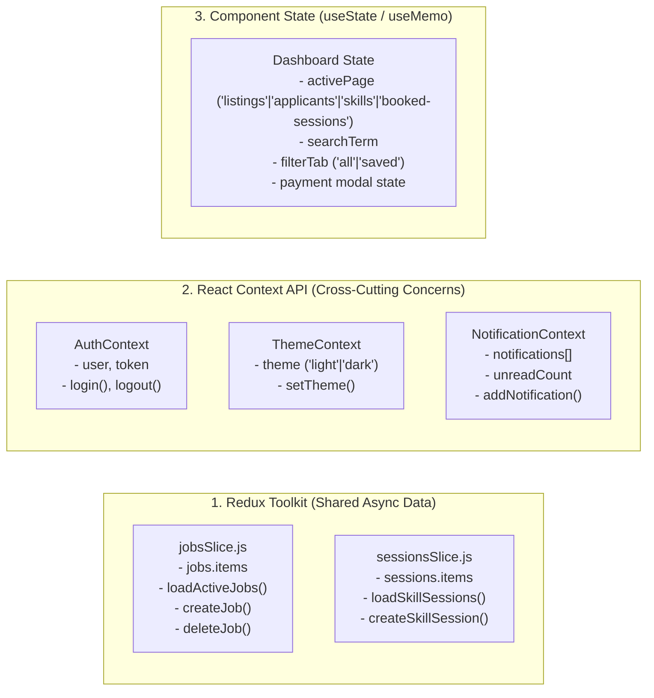

# How the Kairos Project Connects: Architecture & Component Wiring

This document explains the technical architecture, component tree, provider hierarchy, state management layers, Razorpay payment flow, and communication mechanisms of the Kairos frontend application.

---

## 1. Architectural Overview Diagram



---

## 2. Bootstrapping & Provider Hierarchy

The application initializes in [`main.jsx`](file:///c:/Users/yashx/OneDrive/Desktop/FrondEnd%20FINAL/frontend/src/main.jsx) and wraps the component tree in a layered provider hierarchy:

```jsx
// main.jsx
<StrictMode>
  <Provider store={store}>       {/* Redux Toolkit store */}
    <App />
  </Provider>
</StrictMode>
```

Within [`App.jsx`](file:///c:/Users/yashx/OneDrive/Desktop/FrondEnd%20FINAL/frontend/src/App.jsx), providers are nested to supply global cross-cutting state:

```jsx
// App.jsx
<ThemeProvider>                 {/* 1. Theme State (light/dark mode toggle) */}
  <AuthProvider>                {/* 2. Authentication State (user session, login/logout) */}
    <NotificationProvider>      {/* 3. Notification State (toasts, unread popover items) */}
      <HashRouter>              {/* 4. Client-side Routing */}
        <Routes> ... </Routes>
        <ToastRegion />         {/* Global floating toast notification container */}
      </HashRouter>
    </NotificationProvider>
  </AuthProvider>
</ThemeProvider>
```

---

## 3. Route Guard & Role-Based Security

Protected pages are wrapped with [`ProtectedRoute.jsx`](file:///c:/Users/yashx/OneDrive/Desktop/FrondEnd%20FINAL/frontend/src/components/ProtectedRoute.jsx):

```jsx
<Route
  path="/recruiter"
  element={
    <ProtectedRoute allowedRole="Recruiter">
      <RecruiterDashboard />
    </ProtectedRoute>
  }
/>
```

- Reads `user` from `useAuth()`.
- **Not logged in**: Redirects to `/#/login`.
- **Wrong role**: Automatically redirects to authorized workspace.
- **Authorized**: Renders target page.

---

## 4. State Management Architecture



---

## 5. Razorpay Integration Architecture (`utils/razorpay.js`)

Kairos connects with the official Razorpay Checkout SDK for frictionless peer session micro-transactions:

1. **Dynamic Script Loading**:
   `loadRazorpayCheckout()` dynamically appends `https://checkout.razorpay.com/v1/checkout.js` on demand, eliminating redundant initial payload size.
2. **Environment Key**:
   Reads `import.meta.env.VITE_RAZORPAY_KEY_ID`. In production / GitHub Actions, this is securely injected via GitHub Secrets.
3. **Promise-Wrapped Checkout**:
   `payWithRazorpay({ amount, description, prefill })` wraps the `window.Razorpay` event handlers into a clean Promise that resolves with `response.razorpay_payment_id` on payment success or rejects if cancelled.
4. **Active vs. Cancelled Booking Separation**:
   Cancelled bookings remain stored for user refund auditing in the **History** tab, but are ignored by duplicate booking checks so students can seamlessly re-book the same session later if desired.

---

## 6. Service & Data Mock Layer (`api.js`)

All asynchronous business logic connects through [`frontend/src/services/api.js`](file:///c:/Users/yashx/OneDrive/Desktop/FrondEnd%20FINAL/frontend/src/services/api.js).

### Features:
1. **Async Simulation (`asyncWrap`)**: Returns Promises with realistic micro-delays (40ms) to ensure true asynchronous component lifecycles.
2. **Dual-Role Persistent Store**:
   - Seeded initial state for recruiters, jobs, student portfolios, applications, and skill sessions.
   - Applications, job vacancies, and session bookings persist in `localStorage`.
3. **Refund Generation & Cancellation Locking**:
   - Generates mock refund records (`rfnd_...`) when a paid booking is cancelled.
   - Once a meeting link is published by the host, cancellations are strictly locked to protect confirmed attendees.
4. **Cross-Component Event Bus**:
   - Emits custom window events (`kairos_application_updated`, `kairos_sessions_updated`) to sync seats, application statuses, and meeting links instantly across open tabs.

---

## 7. Styling Architecture

All styling is managed through unified Vanilla CSS design tokens in [`index.css`](file:///c:/Users/yashx/OneDrive/Desktop/FrondEnd%20FINAL/frontend/src/index.css) and dedicated component stylesheets:
- `SkillExchangePage.css`
- `BookedSessionsPage.css`
- `MySessionsPage.css`
- `SessionForm.css`

Responsive CSS grid layouts and native media queries automatically handle mobile and desktop view transitions without external CSS frameworks.
